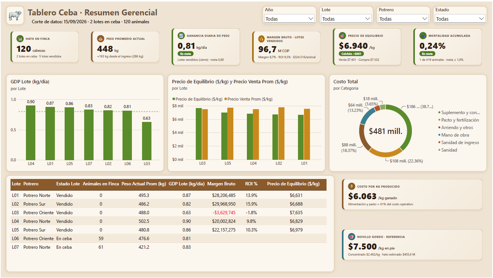
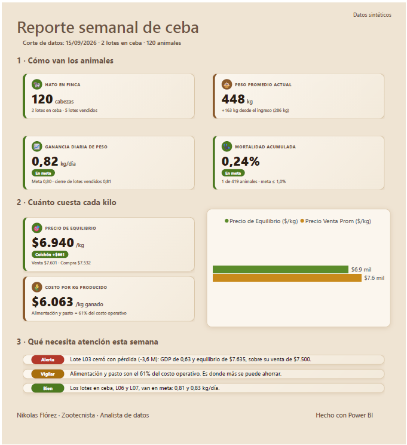
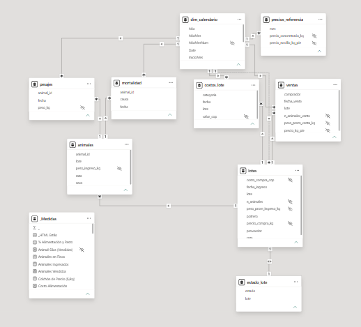

# Tablero de ceba bovina · Power BI

Tablero gerencial para una operación de ceba: hato en finca, ganancia
diaria de peso (GDP), costos, margen y mortalidad por lote.
Datos de muestra.

## Tablero

## Reporte semanal (lo que recibe el cliente)
El tablero alimenta un reporte de una página, pensado para enviarse por
WhatsApp: cómo van los animales, cuánto cuesta cada kilo y qué necesita
atención esta semana. Las alertas se generan solas con DAX.

## Modelo de datos
Modelo en estrella con calendario único, 10 tablas y medidas DAX
organizadas por carpetas.

## Qué responde
- ¿Qué lotes cumplen la meta de GDP (0,80 kg/día)?
- ¿Cuál es el precio de equilibrio y el margen por lote vendido?
- ¿Cuánto pesa el costo de alimentación sobre el costo operativo?
- ¿Cuál es la mortalidad acumulada?

## Hallazgos del ejemplo
- 5 lotes vendidos con 96,7 M COP de margen bruto
- El lote L03 perdió dinero: GDP de 0,63 y precio de equilibrio por encima de su precio de venta
- La alimentación y el pasto son el 61 % del costo operativo

## Herramientas
Power BI · DAX · Modelado en estrella · Tarjetas HTML · Temas JSON
